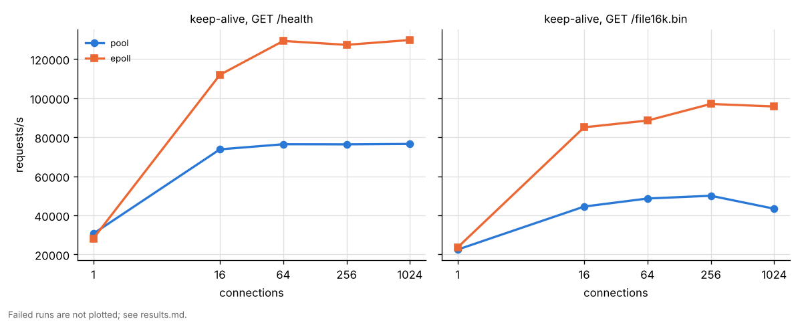
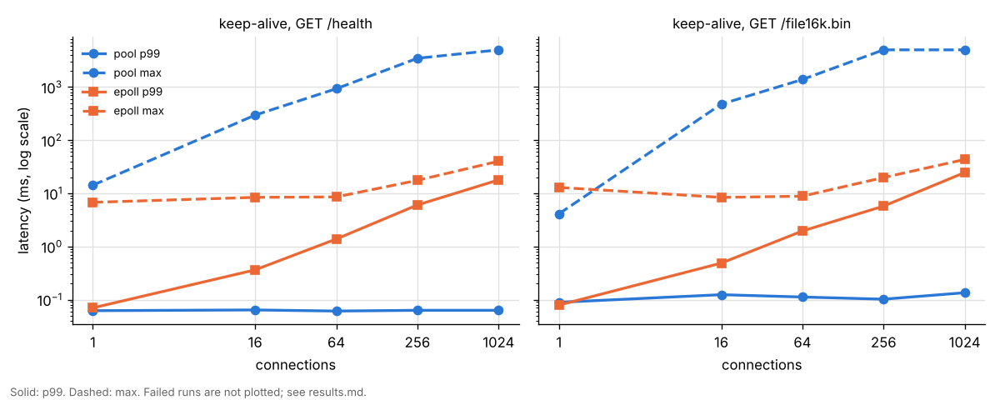

# cpp-http-server

An HTTP/1.1 server written from raw TCP sockets in C++17 for Linux, with no
third-party libraries. One binary has two concurrency models behind a flag: a
blocking **thread pool** (`--mode pool`) and **edge-triggered epoll** event
loops (`--mode epoll`, the default). Both share the same incremental parser,
router, handlers and response code, so the benchmarks compare the two designs
and nothing else. The repo includes its own load generator, a benchmark suite
with published results, unit and integration tests, and AddressSanitizer,
UndefinedBehaviorSanitizer and ThreadSanitizer builds. It is a study project,
not a production server.

## Features

| Feature | Where it is tested |
|---|---|
| Incremental request parser: any split of the input, pipelining, strict CRLF, `Content-Length` bodies, limits (400, 413, 431, 501, 505) | `tests/unit/parser_test.cpp` (every input also fed one byte at a time), `test_errors.py` |
| Router with path parameters (`/api/users/:id`), 404, 405 with `Allow`, `HEAD` through `GET`, 501 for unknown methods | `router_test.cpp`, `test_errors.py` |
| Static files from `--root` with `realpath` containment, `index.html`, MIME types | `static_test.cpp` (`..`, symlink escapes, sibling-prefix roots), `test_basic.py` |
| JSON endpoints: `/health`, `/api/stats`, `/api/time`, `POST /api/echo`, `/api/users/:id` | `routes_test.cpp`, `json_test.cpp`, `test_basic.py` |
| Keep-alive, pipelining in order, `Connection: close`, HTTP/1.0, `--max-keepalive-requests` | `http_conn_test.cpp`, `test_keepalive.py` |
| Request, keep-alive and write timeouts, including slow-header (slowloris) clients | `test_timeouts.py` |
| Graceful shutdown on SIGINT/SIGTERM: in-flight requests finish, idle connections close, grace deadline | `test_shutdown.py` |
| Output backpressure: a client that pipelines without reading cannot grow server memory | `http_conn_input_bounded_under_pipelining`, `test_pipeline_flood_bounded` |
| Pool mode: bounded queue, `503` when full | `thread_pool_test.cpp`, `test_pool_only.py` |
| Survives descriptor exhaustion (`EMFILE`) and clients that vanish mid-response | `test_resources.py`, `test_epoll_only.py`, `test_errors.py` |
| Load generator with p50/p95/p99/max latency | `percentile_test.cpp`, `test_loadgen.py` |

The integration suite (Python 3 standard library, raw sockets) runs unchanged
against both modes; a few tests are specific to one mode.

## Quick start

Needs Linux, CMake 3.16 or later and GCC 13 or Clang with C++17.

```sh
git clone https://github.com/<your-username>/cpp-http-server.git
cd cpp-http-server
cmake -S . -B build
cmake --build build -j
./build/httpserver --port 8080          # epoll mode; serves ./www; Ctrl-C to stop
```

In another terminal:

```sh
curl -si http://localhost:8080/health
curl -s http://localhost:8080/api/users/42
curl -s -X POST --data 'hello' http://localhost:8080/api/echo   # echoes method, path, body
```

`./build/httpserver --mode pool` runs the thread-pool model; `--help` lists every flag.

## Architecture

```
                 +----------------------- shared -----------------------+
 bytes in  --->  | HttpParser -> Request -> Router -> Handler -> Response | ---> bytes out
                 +------------------------------------------------------+
                      ^                                         ^
        +-------------+--------------+           +--------------+-------------+
        | pool mode                  |           | epoll mode                 |
        | acceptor thread            |           | N event-loop threads       |
        | bounded queue of fds       |           | each: own listen socket    |
        | N workers, blocking I/O,   |           | (SO_REUSEPORT), own epoll, |
        | one connection per worker  |           | non-blocking I/O, many     |
        |                            |           | connections per thread     |
        +----------------------------+           +----------------------------+
```

The HTTP side of a connection is `HttpConn` (`src/server/http_conn.h`), a class
with no socket in it: a server pushes in the bytes it read and writes out the
responses `process()` produced. Pipelining order, keep-alive decisions and
output backpressure are therefore written and unit-tested once, and both
servers follow the same read contract (read only while nothing is buffered and
less than 1 MiB of output is waiting).

**Pool mode** (`src/server/pool_server.cpp`). An acceptor thread waits in
`poll` on the listening socket and an eventfd used for shutdown, accepts, and
hands each socket to a `ThreadPool` with a bounded queue. If the queue is full
it answers `503` without blocking and closes. A worker owns its connection
until it closes, using blocking `recv`/`send` with 100 ms `SO_RCVTIMEO` /
`SO_SNDTIMEO` ticks so it notices deadlines and shutdown. Simple and fast per
request, but every open connection, idle or not, holds a worker.

**Epoll mode** (`src/server/epoll_server.cpp`). `--threads` event loops, each
with its own listening socket (`SO_REUSEPORT`, so the kernel spreads new
connections), its own epoll instance and its own connections. A connection
never leaves the loop that accepted it, so connection state needs no locks;
the only cross-thread state is the stop flag, one wake-up eventfd per loop,
the statistics counters and the logger. Handlers run inline on the loop.

### Life of a request in epoll mode

1. A client connects; the kernel queues it on one loop's listening socket. The
   edge-triggered `EPOLLIN` makes `accept_ready` call `accept4` until `EAGAIN`.
   `add_connection` sets `TCP_NODELAY`, creates the connection, starts its
   keep-alive clock and registers `EPOLLIN | EPOLLRDHUP | EPOLLET`.
2. Request bytes raise `EPOLLIN`. `drive` reads 16 KiB at a time until `EAGAIN`
   or until the output mark in step 3 stops it (with edge triggering, stopping
   for any other reason would lose the event); each chunk goes to
   `HttpConn::on_data` and `process`, which parses, dispatches through the
   router and appends the serialized response.
3. `flush` sends at once. If the socket buffer fills, `update_interest` adds
   `EPOLLOUT`; the next writable event resumes sending, and `EPOLLOUT` is
   removed as soon as the output has drained. With 1 MiB or more waiting,
   reading stops until the client catches up; the `EPOLLOUT` event that follows
   brings the loop back to read the rest, since no new `EPOLLIN` edge will come
   for bytes already in the socket.
4. After every event `update_deadline` files the connection under its write,
   request or keep-alive deadline. These are three lists ordered by deadline;
   an update is usually a move to the back of a list, and `epoll_wait` sleeps
   until the earliest deadline (at most 1 s). An expired request deadline
   queues a `408`; the other two close the connection.
5. The connection closes after `Connection: close`, the keep-alive request
   limit, a parse error, the client's FIN once its responses are sent, a reset,
   or a timeout. `close_conn` removes it from epoll and its timer list and
   frees it after the current batch of events, so a later event in the same
   batch cannot touch freed memory and its fd number cannot be reused yet.

## Configuration

| Flag | Default | Meaning |
|---|---|---|
| `--mode pool\|epoll` | `epoll` | concurrency model |
| `--bind ADDR` | `0.0.0.0` | IPv4 address to listen on |
| `--port N` | `8080` | TCP port; `0` picks a free one |
| `--threads N` | CPU count | pool workers or event loops (1-1024) |
| `--root DIR` | `./www` | static file root |
| `--backlog N` | `1024` | `listen` backlog |
| `--queue-capacity N` | `1024` | pool mode: accepted connections waiting for a worker |
| `--request-timeout SEC` | `10` | first byte of a request to the full request; then `408` and close |
| `--keepalive-timeout SEC` | `5` | idle time allowed between requests; then close |
| `--write-timeout SEC` | `10` | time without write progress; then close |
| `--shutdown-grace SEC` | `5` | time in-flight requests get after SIGINT/SIGTERM |
| `--max-keepalive-requests N` | `1000` | requests per connection before `Connection: close` |
| `--max-header-bytes N` | `8192` | request line plus headers; larger gets `431` |
| `--max-body-bytes N` | `1048576` | request body; larger gets `413` |
| `--log-level LEVEL` | `info` | `debug`, `info`, `warn` or `error` (stderr) |
| `--access-log` | off | one log line per request |

Timeouts accept fractions (`0.5`). Invalid flags print the usage and exit with status 2.

## Benchmarks

**Environment.** A 2-core cloud VM (Intel Xeon @ 2.10 GHz, 7.8 GiB, Linux
6.18, GCC 13.3, `-O2`). Client and server ran on the same VM over loopback, so
they shared the two cores. Server `--threads 2`; the in-repo load generator
`bench/loadgen` with one thread (`-t 1`), 1 s warm-up, 10 s measured, closed
loop, 5 s request timeout. Full details: [`bench/results/environment.txt`](bench/results/environment.txt).
Reproduce with `bench/run.sh` (about 32 runs of 11 s each), or `bench/run.sh --quick` for a
short smoke run written to `build/bench-quick/`.




### Keep-alive, `GET /health`

Each connection sends requests back to back on one keep-alive connection; the response is a small JSON body.

| mode | connections | idle | req/s | p50 (ms) | p95 (ms) | p99 (ms) | max (ms) | errors |
|---|---:|---:|---:|---:|---:|---:|---:|---|
| pool | 1 | 0 | 30590 | 0.030 | 0.041 | 0.062 | 14.3 | 0 |
| pool | 16 | 0 | 73769 | 0.023 | 0.045 | 0.064 | 296.4 | 0 |
| pool | 64 | 0 | 76374 | 0.023 | 0.043 | 0.061 | 930.5 | 0 |
| pool | 256 | 0 | 76320 | 0.023 | 0.043 | 0.063 | 3477.5 | 0 |
| pool | 1024 | 0 | 76538 | 0.023 | 0.044 | 0.063 | 5003.6 | 629 (timeout 629) |
| epoll | 1 | 0 | 28108 | 0.031 | 0.052 | 0.070 | 6.772 | 0 |
| epoll | 16 | 0 | 111930 | 0.132 | 0.253 | 0.363 | 8.404 | 0 |
| epoll | 64 | 0 | 129250 | 0.463 | 1.037 | 1.382 | 8.562 | 0 |
| epoll | 256 | 0 | 127256 | 1.556 | 5.385 | 6.040 | 17.6 | 0 |
| epoll | 1024 | 0 | 129737 | 6.978 | 15.1 | 17.9 | 40.2 | 0 |

### Keep-alive, `GET /file16k.bin`

Same as above, serving a 16 KiB static file from memory.

| mode | connections | idle | req/s | p50 (ms) | p95 (ms) | p99 (ms) | max (ms) | errors |
|---|---:|---:|---:|---:|---:|---:|---:|---|
| pool | 1 | 0 | 22440 | 0.039 | 0.065 | 0.089 | 4.125 | 0 |
| pool | 16 | 0 | 44480 | 0.035 | 0.083 | 0.124 | 476.6 | 0 |
| pool | 64 | 0 | 48602 | 0.033 | 0.075 | 0.112 | 1386.4 | 0 |
| pool | 256 | 0 | 50010 | 0.033 | 0.072 | 0.102 | 5009.7 | 5 (timeout 5) |
| pool | 1024 | 0 | 43383 | 0.035 | 0.086 | 0.135 | 5008.9 | 843 (timeout 843) |
| epoll | 1 | 0 | 23512 | 0.039 | 0.054 | 0.079 | 12.9 | 0 |
| epoll | 16 | 0 | 85054 | 0.176 | 0.308 | 0.487 | 8.396 | 0 |
| epoll | 64 | 0 | 88498 | 0.711 | 1.366 | 1.958 | 8.835 | 0 |
| epoll | 256 | 0 | 97004 | 2.748 | 4.612 | 5.752 | 19.9 | 0 |
| epoll | 1024 | 0 | 95702 | 9.142 | 21.1 | 24.6 | 43.3 | 0 |

### New connection per request, `GET /health`

Every request opens a new TCP connection; latency includes connect and accept.

| mode | connections | idle | req/s | p50 (ms) | p95 (ms) | p99 (ms) | max (ms) | errors |
|---|---:|---:|---:|---:|---:|---:|---:|---|
| pool | 16 | 0 | 39055 | 0.289 | 0.552 | 0.800 | 7.487 | 0 |
| pool | 64 | 0 | 38821 | 1.160 | 2.426 | 3.436 | 15.6 | 0 |
| pool | 256 | 0 | 44192 | 4.349 | 7.752 | 10.3 | 37.4 | 0 |
| epoll | 16 | 0 | 42779 | 0.262 | 0.555 | 0.886 | 6.373 | 0 |
| epoll | 64 | 0 | 49306 | 0.976 | 1.847 | 2.761 | 8.056 | 0 |
| epoll | 256 | 0 | 44644 | 4.092 | 8.362 | 11.1 | 38.1 | 0 |

### Idle clients, `GET /health`

64 active keep-alive connections, plus idle connections that are opened before the run and never send anything.

| mode | connections | idle | req/s | p50 (ms) | p95 (ms) | p99 (ms) | max (ms) | errors |
|---|---:|---:|---:|---:|---:|---:|---:|---|
| pool | 64 | 0 | 75402 | 0.023 | 0.044 | 0.059 | 930.5 | 0 |
| pool | 64 | 256 (117 closed by server) |  |  |  |  |  | failed: no successful request (64 errors: timeout 64) |
| pool | 64 | 1024 (118 closed by server) |  |  |  |  |  | failed: no successful request (64 errors: timeout 64) |
| epoll | 64 | 0 | 131559 | 0.454 | 1.029 | 1.405 | 8.503 | 0 |
| epoll | 64 | 256 (256 closed by server) | 129966 | 0.454 | 1.043 | 1.434 | 9.658 | 0 |
| epoll | 64 | 1024 (1024 closed by server) | 127182 | 0.461 | 1.043 | 1.471 | 8.508 | 0 |

### What the numbers show

- **One connection: the two modes are equal.** 30.6k vs 28.1k req/s on
  `/health` is within the run-to-run noise. With one request in flight the
  cost is the round trip, and both modes run the same code per request.
- **From 16 connections up, epoll does about 1.5-1.7x the pool's throughput on
  `/health`** (112k-130k vs 74k-77k req/s) and about 1.8-2.2x on the 16 KiB
  file. With two threads the pool serves at most two connections at a time;
  an event loop serves every connection that is ready and amortises each
  `epoll_wait` over many of them.
- **The pool's p50/p95/p99 look better than epoll's, and that is misleading.**
  A pool worker stays with one keep-alive connection until it closes, which
  for a busy client is after `--max-keepalive-requests` (1000) requests. A
  request is therefore either served at once by a dedicated thread or waits
  for whole worker turns of other connections. About 1 request in 1000 pays
  that wait: too few to reach p99, which stays at 0.06 ms, while the max
  column climbs from 296 ms (16 connections) to 3.5 s (256). At 1024
  connections the wait passes loadgen's 5 s timeout, so 629 requests are
  counted as errors and are absent from the percentiles. Epoll shares the
  threads fairly: its latency grows smoothly with concurrency (p99 0.36 ms at
  16 connections, 17.9 ms at 1024), its max stays at about 40 ms, and it has zero errors.
- **New connection per request: no meaningful difference** (39k-44k vs
  43k-49k connections/s). Each connection carries one request, so no worker is
  pinned, and the single client thread, busy with `connect` and `close`, is the
  limit.
- **Idle clients.** Epoll is unaffected by 256 or 1024 idle connections
  (127k-132k req/s, p99 about 1.4 ms); an idle connection costs a descriptor,
  a small heap-allocated connection object, a timer-list entry and its kernel
  socket buffers, not a thread. The pool serves nothing: every worker is
  pinned to an idle connection until the 5 s keep-alive timeout, and the
  active clients sit in the queue behind the remaining idle ones.

**Caveats.** The load generator is closed loop: each connection waits for its
response before sending the next request, so when the server stalls, the
requests that would have arrived meanwhile are never sent or measured
(coordinated omission). The percentiles describe service time as seen by a
client that waits its turn and understate the tail an open-loop client would
see under overload. Each cell is a single 10 s run, and repeated runs on this
VM varied by roughly 15%, so only large differences are findings. Client and
server share two cores, so absolute numbers are a lower bound for the server
on this machine. The results were recorded at the commit named in
`results.md`; two small epoll-server changes landed afterwards (exception-safe
connection setup, and large output buffers released when a connection goes
idle rather than on every drain), and a spot check showed no measurable
throughput change. A later check that an accepted descriptor is not already a
live connection runs once per accept and is not on the request path.

## Testing

```sh
(cd build && ctest --output-on-failure)
```

This runs four suites: `unit` (C++ unit tests on a small in-repo assertion
header, `tests/unit/test.h`), `integration_pool` and `integration_epoll` (the
Python suite against each mode) and `loadgen_smoke`. The integration runner can
also be used directly, with `-k` selecting tests by name:

```sh
python3 tests/integration/run_all.py --binary build/httpserver --mode epoll -k keepalive
```

Sanitizer builds (ASan with UBSan, and TSan) run the same suites;
`HS_TEST_SLOWDOWN` stretches the integration tests' timing windows for the
slower binaries:

```sh
cmake -S . -B build-asan -DCMAKE_BUILD_TYPE=Debug -DHS_SANITIZE=asan
cmake --build build-asan -j
(cd build-asan && HS_TEST_SLOWDOWN=3 ctest --output-on-failure)

cmake -S . -B build-tsan -DCMAKE_BUILD_TYPE=Debug -DHS_SANITIZE=tsan
cmake --build build-tsan -j
(cd build-tsan && HS_TEST_SLOWDOWN=3 ctest --output-on-failure)
```

On recent kernels the sanitizer runtimes may fail at start-up unless
`sudo sysctl vm.mmap_rnd_bits=28` is set first. The integration harness fails
a test on any sanitizer report in a process's output, not only on its exit
code. The GitHub Actions workflow (`.github/workflows/ci.yml`) defines the
release, ASan and TSan configurations as three parallel jobs for every push and
pull request; the release job also checks formatting with `clang-format`.

## Design decisions

- **Two models in one binary** so the trade-off is measured rather than asserted.
  An epoll front end feeding a worker pool would only pay off with slow handlers.
- **Edge-triggered epoll.** A connection is reported again only when new
  bytes arrive, so a loop that has deliberately stopped reading (at the 1 MiB
  output mark) is not woken over and over for data it is not going to read, as
  it would be with level triggering. The price is that every stop must be one
  where another event is guaranteed: reading continues to `EAGAIN`, and after
  an output-mark stop the `EPOLLOUT` event resumes it. The listening socket is
  edge-triggered for the same reason, so a full descriptor table cannot make
  it spin; accepting is retried on a 100 ms timer instead.
- **A listening socket per event loop (`SO_REUSEPORT`)** instead of one acceptor
  handing descriptors to loops: no hand-off queue and no locks. A probe bind
  without `SO_REUSEPORT` makes a second instance on the same port fail instead
  of silently sharing it.
- **Load shedding in pool mode:** a full queue gets a fast `503` instead of
  connections hanging in the kernel backlog.
- **Strict parsing.** Bare LF, obsolete header folding, duplicate `Host`,
  conflicting `Content-Length` and any `Transfer-Encoding` are rejected rather
  than interpreted: lenient framing is how request smuggling happens.
- **Timers as three ordered lists.** Every deadline of one kind is "a recent
  event plus a fixed duration", so a refreshed deadline almost always belongs
  at the back: usually an O(1) `splice`, without a heap. The exception is a
  request clock that started while the connection waited on the write list;
  a short backward walk keeps the list sorted then (O(n) in the worst case).
- **Signal handling in two lines.** The handler only sets an atomic flag and
  writes an eventfd (both async-signal-safe); the real shutdown work runs in
  ordinary code.
- **An in-repo load generator** (epoll-based, nearest-rank percentiles over all
  samples), so every published number can be reproduced from a clone.

`docs/design.md` has the full design and lists where the implementation
differs from it.

## Limitations

Not supported, by design: TLS, HTTP/2, chunked transfer encoding (requests
with `Transfer-Encoding` get `501`), compression, range and conditional
requests, `Expect: 100-continue`, virtual hosts, CGI, a configuration file,
JSON request-body parsing, and platforms other than Linux. Also:

- No per-event read budget: a client that pipelines requests and also reads
  its responses fast enough never reaches the 1 MiB output mark, so it can
  keep its event loop busy indefinitely; nothing bounds the work done for one
  event.
- The write timeout fires only when no byte at all is sent for
  `--write-timeout`. A client that reads slowly but steadily is never cut off,
  and the request timeout is not checked while output is waiting to be sent.
- Memory per connection is bounded but not small: up to about 1 MiB of queued
  output plus one whole response (for a static file, up to 64 MiB), plus a
  partly received request (up to `--max-header-bytes` plus `--max-body-bytes`).
  Together with the previous point, a slow reader can hold that memory for as
  long as it keeps reading.
- Epoll mode has no connection limit or load shedding: it accepts until the
  descriptor limit, then retries on a timer.
- Logging is a blocking `write` to stderr from the serving threads. If stderr is
  a pipe whose reader falls behind (for example with `--access-log`), every
  thread that logs waits for it.
- Shutdown finishes the requests the server has already started on, but some
  requests that have reached the machine are dropped: in epoll mode a
  connection that looks idle is closed at once, even if a request is waiting
  unread in its socket buffer, and in pool mode connections still waiting in
  the queue are closed unserved. Those clients see the connection close or
  reset rather than a `503`.
- No lingering close: closing a connection with unread input can make the
  kernel send a reset that destroys the tail of the final response.
- Static files are read fully into memory (up to 64 MiB), and the disk read
  blocks the event loop briefly.
- Between `realpath` and `open` there is a time-of-check/time-of-use window: if
  an attacker can write to the served tree, a path component swapped for a
  symlink in that window can escape the root.
- Handlers run on the event-loop thread, so a slow handler stalls every
  connection on that loop.
- IPv4 only.
- The pool's `503` is best effort: it is sent once without blocking, and a
  client that had already sent request bytes may see a reset instead.

## Possible extensions

- `sendfile` for static files, avoiding the copy through user space.
- Chunked transfer encoding for request and response bodies.
- TLS.
- A handler offload pool: slow handlers run on worker threads and post their
  responses back to the event loop through an eventfd.
- A per-event read budget, and an open-loop (fixed arrival rate) mode for the
  load generator.

## License

MIT, see [LICENSE](LICENSE).
